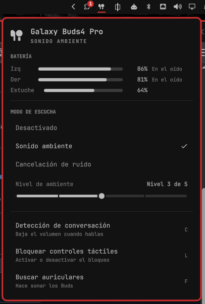
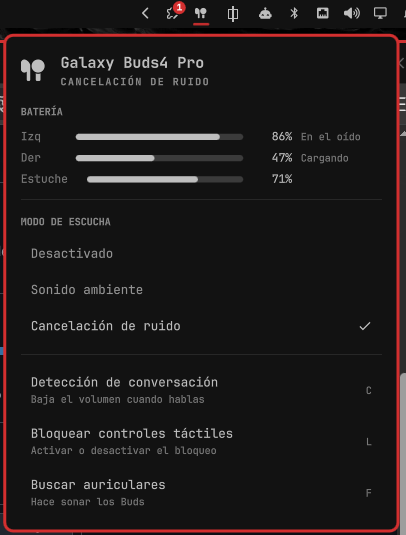

<h1 align="center">Galaxy Buds para Omarchy</h1>

<p align="center">
  Tus Samsung Galaxy Buds en la barra de <a href="https://omarchy.org">Omarchy</a>: batería de cada auricular y del estuche, si están puestos, modo de escucha, nivel de ambiente y acciones rápidas.
</p>

<p align="center">
  <a href="README.md">English</a> ·
  <a href="#instalación">Instalación</a> ·
  <a href="#compatibilidad">Compatibilidad</a> ·
  <a href="#problemas-comunes">Problemas comunes</a>
</p>

<p align="center">
  
  &nbsp;
  
</p>

## Qué hace

- **Batería** del auricular izquierdo, del derecho y del estuche, indicando si cada uno está en el oído, en el estuche o cargando. Se pone en rojo al 20 %.
- **Modo de escucha**: Desactivado, Sonido ambiente o Cancelación de ruido, con una ✓ en el activo. Clic derecho en el icono para pasar al siguiente.
- **Nivel de ambiente** con un deslizador (de 1 a 5 en los Buds4 Pro), visible en modo Sonido ambiente.
- **Acciones rápidas**: detección de conversación, bloqueo táctil y *Buscar auriculares*.
- **Se maneja con el teclado**, como los paneles de Omarchy: `O` `A` `N` eligen el modo, las flechas mueven y ajustan, `C` `L` `F` ejecutan las acciones y `Tab` pasa al panel vecino.
- **Sin consultas periódicas**. Un pequeño puente escribe los cambios en un archivo que el panel vigila, así que en reposo no gasta nada.

## Cómo funciona

```
Galaxy Buds ──Bluetooth──► GalaxyBudsClient ──D-Bus──► galaxybuds-bridge ──► ~/.local/state/galaxybuds/status.json ──► panel
                                  ▲                                                                                       │
                                  └──────────────────────────── llamadas D-Bus al hacer clic ◄────────────────────────────┘
```

[GalaxyBudsClient](https://github.com/timschneeb/GalaxyBudsClient) hace la parte difícil: habla el protocolo de Samsung con los audífonos y publica su estado por D-Bus. `bin/galaxybuds-bridge` copia ese estado a un archivo JSON, y el panel lo lee.

## Instalación

Necesitas Omarchy, tus Galaxy Buds emparejados por Bluetooth y una computadora x86_64 para la versión parcheada de GalaxyBudsClient (ver más abajo).

```bash
omarchy plugin add https://github.com/AJHH24/omarchy-galaxybuds
~/.config/omarchy/plugins/ajhh.galaxybuds/setup
```

`omarchy plugin add` solo descarga el plugin. `setup` hace lo demás:

1. Instala `galaxybudsclient-bin` del AUR. Te pedirá tu contraseña de sudo.
2. Descarga la versión parcheada de GalaxyBudsClient desde la [release](https://github.com/AJHH24/omarchy-galaxybuds/releases/tag/gbc-ipc-1) de este repo, comprueba su SHA256 y la instala en `~/.local/opt/galaxybudsclient-ipc`.
3. Instala y arranca dos servicios de usuario: `galaxybudsclient` (minimizado en la bandeja) y `galaxybuds-bridge`.
4. Activa el widget en la barra.

Después abre **GalaxyBudsClient** una vez desde el lanzador (`Super + Space`) y elige tus Buds en el asistente. Listo.

Puedes volver a ejecutar `setup` cuando quieras; no rompe nada.

## Uso

| Acción | Resultado |
|---|---|
| Clic izquierdo en el icono | Abre el panel |
| Clic derecho en el icono | Siguiente modo de escucha |
| `O` / `A` / `N` | Desactivado / Sonido ambiente / Cancelación de ruido |
| `←` `→` en el deslizador | Bajar / subir el nivel de ambiente |
| `C` / `L` / `F` | Detección de conversación / Bloqueo táctil / Buscar auriculares |
| `R` | Actualizar |

Desde scripts o atajos de Hyprland:

```bash
omarchy-shell galaxybuds toggle          # abrir o cerrar el panel
omarchy-shell galaxybuds cycle           # siguiente modo de escucha
omarchy-shell galaxybuds off|ambient|anc # elegir un modo
omarchy-shell galaxybuds ambientLevel 3  # 1..5
omarchy-shell galaxybuds mode            # muestra el modo actual
omarchy-shell galaxybuds battery         # muestra la batería
```

Para ocultar el icono cuando no hay Buds conectados, pon `hideWhenDisconnected` en `true` en la entrada del widget dentro de `~/.config/omarchy/shell.json`.

## Compatibilidad

El panel solo muestra lo que GalaxyBudsClient informa para cada modelo.

| Modelo | Batería y en el oído | Modo de escucha | Nivel de ambiente |
|---|:---:|:---:|:---:|
| Galaxy Buds4 Pro | ✅ | ✅ | ✅ 5 niveles |
| Galaxy Buds Pro | ✅ | ✅ | ✅ 4 niveles |
| Galaxy Buds2, Buds3, Buds4 | ✅ | ✅ | ✅ 3 niveles |
| Galaxy Buds2 Pro, Buds3 Pro, Buds3 FE, Buds FE, Buds Core | ✅ | ✅ | — |
| Galaxy Buds+, Galaxy Buds (2019), Buds Live | ✅ | solo alternar | — |

Solo los **Buds4 Pro** se han probado con hardware real. Los demás usan el mismo código.

## La versión parcheada de GalaxyBudsClient

GalaxyBudsClient 5.2.1 funciona tal cual, pero con él el panel no puede mostrar ni elegir el modo de escucha ni el nivel de ambiente, y en Linux puede perder los audífonos después de guardarlos en el estuche. Envié las correcciones al proyecto original:

| PR | Qué corrige |
|---|---|
| [#751](https://github.com/timschneeb/GalaxyBudsClient/pull/751) | Caracteres nulos en textos de D-Bus hacían que el bus expulsara a la app al reconectar |
| [#752](https://github.com/timschneeb/GalaxyBudsClient/pull/752) | Los vigilantes de BlueZ nunca se daban de baja y rompían la reconexión automática |
| [#753](https://github.com/timschneeb/GalaxyBudsClient/pull/753) | Publica por D-Bus el modo de escucha y el nivel de ambiente |

Mientras no salgan en una versión oficial, `setup` instala una compilación de `master` con esos tres PRs. GalaxyBudsClient es GPLv3, y el código de esa compilación está en las [ramas del fork](https://github.com/AJHH24/GalaxyBudsClient/branches). Para compilarla tú:

```bash
git clone https://github.com/AJHH24/GalaxyBudsClient && cd GalaxyBudsClient
git switch feat/ipc-noise-control-v2
git merge origin/fix/ipc-strip-nul-strings origin/fix/linux-bluez-watcher-leak
curl -fsSL https://dot.net/v1/dotnet-install.sh | bash -s -- --jsonfile global.json --install-dir ~/.dotnet
export DOTNET_ROOT=~/.dotnet PATH=~/.dotnet:$PATH
dotnet publish GalaxyBudsClient/GalaxyBudsClient.csproj -c Release -r linux-x64 \
  --self-contained -p:PublishSingleFile=true -o ~/.local/opt/galaxybudsclient-ipc
systemctl --user restart galaxybudsclient
```

Cuando los PRs salgan en una versión oficial, puedes volver al paquete del AUR:

```bash
rm ~/.config/systemd/user/galaxybudsclient.service.d/ipc-noise-control.conf
rm ~/.local/share/applications/galaxybudsclient.desktop
systemctl --user daemon-reload && systemctl --user restart galaxybudsclient
```

## Problemas comunes

**Los Buds suenan pero el panel dice que no están conectados.** GalaxyBudsClient se rinde para siempre si los Buds estaban apagados cuando arrancó. El puente lo resuelve: cuando BlueZ conecta los Buds y la app sigue sin ellos tras 4 segundos, le pide que se conecte. También puedes hacerlo a mano:

```bash
gdbus call --session --dest me.timschneeberger.GalaxyBudsClient \
  --object-path /me/timschneeberger/galaxybudsclient \
  --method me.timschneeberger.GalaxyBudsClient.Application.ExecuteAction Connect
```

**"GalaxyBudsClient no está abierto".** Revisa el servicio con `systemctl --user status galaxybudsclient`.

**Un dispositivo a la vez.** Los Buds se conectan a un solo dispositivo a la vez. Mientras estén en tu teléfono o en otra computadora, este panel los mostrará desconectados.

**El widget dejó de cargar después de editarlo.** Ejecuta `omarchy restart shell`. La recarga en caliente puede conservar el QML viejo tras un error.

## Desinstalar

```bash
systemctl --user disable --now galaxybuds-bridge galaxybudsclient
rm ~/.config/systemd/user/galaxybuds-bridge.service ~/.config/systemd/user/galaxybudsclient.service
rm -r ~/.config/systemd/user/galaxybudsclient.service.d ~/.local/opt/galaxybudsclient-ipc
rm ~/.local/share/applications/galaxybudsclient.desktop
omarchy plugin remove ajhh.galaxybuds
```

## Créditos

- [GalaxyBudsClient](https://github.com/timschneeb/GalaxyBudsClient) de Tim Schneeberger, que es quien habla con los audífonos.
- El panel sigue el diseño de [omarchy-pods](https://github.com/thisisgm/omarchy-pods), el plugin de AirPods para Omarchy.

Sin relación con Samsung. Galaxy Buds es una marca de Samsung Electronics.

## Licencia

[MIT](LICENSE)
